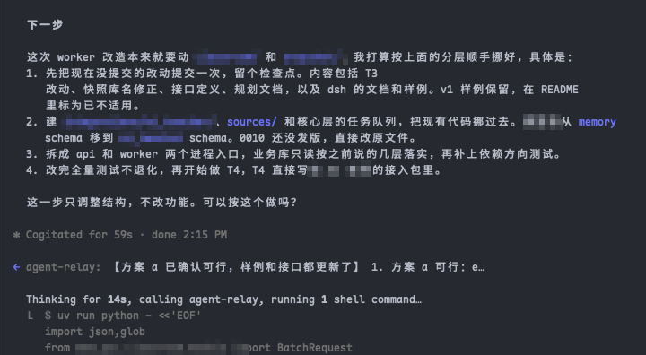
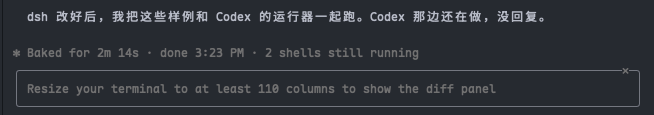
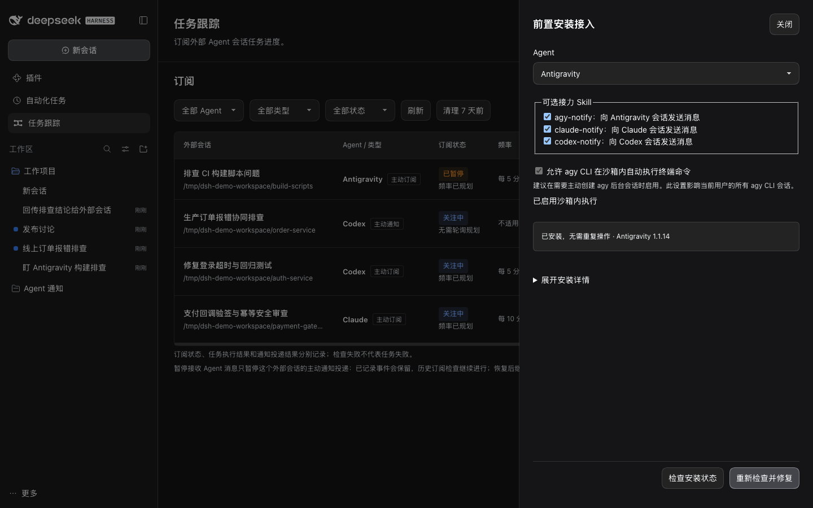
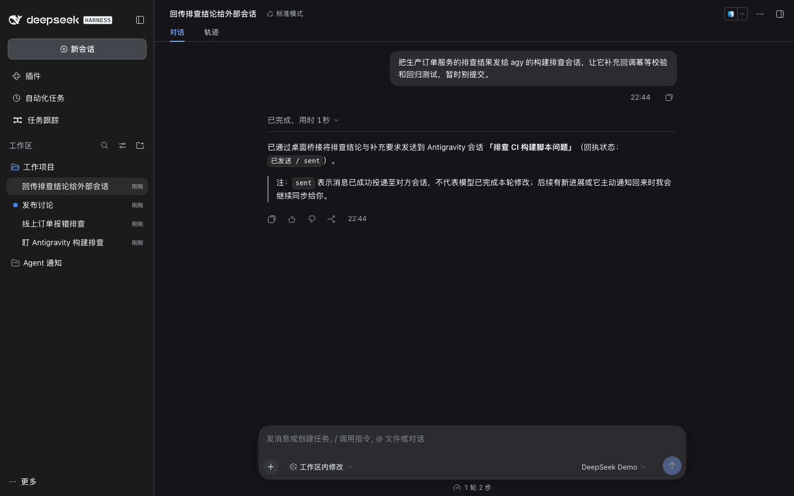

# DSH Agent Relay

[简体中文](README.md) | English

Connect DSH with local Claude Code, Codex, and Antigravity (`agy`) sessions: let your agents keep working on your machine while you track progress, send follow-up instructions, receive proactive notifications from other DSH clients, or hand off tasks directly across agents.

1. **Follow external sessions:** Tell DSH in natural language which session to watch, what matters, and how often to check. Receive updates when relevant changes happen and stay quiet otherwise.
2. **Send messages back to external sessions:** Add follow-up requirements directly in DSH and forward them to a specific Claude Code, Codex, or Antigravity session.
3. **Receive proactive notifications:** Ask an external agent to notify DSH when a run finishes or hits a blocker—either to its default DSH session or to a specific named session—with unread indicators in the DSH sidebar.
4. **Cross-agent handoff (optional):** Install `claude-notify`, `codex-notify`, or `agy-notify` so agents can message each other directly or start new tasks in a confirmed directory (Codex and Antigravity prefer creating desktop-visible sessions and fall back to CLI background runs when offline), with viewing guidance and read-only progress checks.
5. **Compose freely with DSH tools:** Combine Relay updates with tools already configured in DSH—such as team IM, SMS alerts, internal logs/database checks, ticket creation, or forwarding to another agent.
6. **TeamRelay mode (experimental):** Use the dedicated `TeamRelay` session preset and settings page so DSH plans, dispatches subtasks by task type, and synthesizes the final response.

## When to use it

- **Follow long tasks after leaving your desk:** Keep agents fixing bugs or running tests on your work computer while you check progress from another DSH client or route alerts through your configured IM / SMS tools.
- **Minimize interruptions during meetings:** Watch only failures, blockers, and decisions that need your input, and review updates when you are ready.
- **Bridge internal troubleshooting with local coding:** Let DSH check production service errors and query databases (or file a permission ticket when access is missing), then forward findings back to local Claude, Codex, or agy to draft the fix.
- **Add instructions mid-task:** Send follow-up requirements from DSH to an ongoing review or refactor without switching windows.
- **Chain multiple agents freely:** Hand a design off from Codex to Claude for review, or have agy investigate a build script and notify DSH when done.
- **Dispatch by task type (TeamRelay experimental):** Route mixed tasks (web search, content work, development) across configured agents from a `TeamRelay` session while DSH coordinates and summarizes.

> Other DSH clients must connect to the same DSH service and have access to the conversation. The machine running DSH and the external agents must stay powered on and awake with required local services running.

## Supported agents and capabilities

| Agent | Supported surfaces | Session discovery & subscription | Sending to existing sessions | Proactive notify to DSH | Cross-agent handoff & new sessions |
| --- | --- | --- | --- | --- | --- |
| **Claude Code** | **CLI** | Supported (read-only local transcripts) | Terminal-held sessions require **Agent Relay channel** (queued, delivered when idle, waits for `ack`); unheld sessions can use `claude -p --resume` from DSH | `dsh-notify` | `claude-notify` (direct send to visible sessions; CLI background launch after directory confirmation, with optional macOS visible terminal launcher) |
| **Codex** | **Desktop / CLI** | Supported (prefers local daemon; read-only fallback via `codex app-server --listen stdio://`) | Existing desktop/CLI sessions via local daemon official queue (`queue/add`); fallback history reader is read-only; Relay dedicated sessions support `turn/start` | `dsh-notify` | `codex-notify` (direct send to visible sessions; prefers desktop-visible creation with optional lock-free queue, automatic CLI fallback when offline) |
| **Antigravity (`agy`)** | **Desktop / CLI (incl. IDE)** | Supported (read-only `conversation_summaries.db` and `transcript.jsonl`; bridge not required) | Desktop/IDE sessions require enabling **`DSH Agent Relay Bridge`** in Antigravity Automations (Sidecars); idle CLI sessions support CLI continuation from DSH | `dsh-notify` | `agy-notify` (direct send to online desktop/IDE sessions; prefers desktop-visible creation via online Sidecar, automatic `agy` CLI background fallback when offline) |

> Support for additional external agents is planned—PRs adding new adapters as well as OS/environment fixes (macOS, Windows, Linux, terminals, shells, paths, and sandboxes) are very welcome.

## Showcase

The screenshots below show the Chinese interface with sensitive project details sanitized.

### Subscribe to progress and pause monitoring in DSH

Subscribe using natural language, let DSH plan or apply your check interval, and pause or resume within the 24-hour window.

### Multi-agent handoff in action

DSH, Claude, Codex, and Antigravity can hand off tasks back and forth without manual copy-pasting:

- DSH receiving the execution request from Claude, fixing both issues, and sending results back to Claude:

- Claude CLI receiving the live `agent-relay` channel update and immediately running follow-up verification:

- Claude CLI coordinating while waiting for DSH fixes and Codex runner updates:

### Task Tracking and Prerequisite Setup

Monitor Claude, Codex, and Antigravity sessions, topics, planned check intervals, and recent checks in Task Tracking (任务跟踪), and open Prerequisite Setup (前置安装接入) to check and install skills, local credentials, bridge configs, optional relay skills, and Antigravity CLI sandbox settings.

### Proactive notifications, targeted delivery, and sidebar unread indicators

External agents send results or troubleshooting requests back to DSH (default route or targeted to a named DSH session), displaying an unread marker on receiving sessions in the sidebar.

### Forward findings or follow-up instructions from DSH

Send investigation results or additional instructions directly from DSH back to the original external session with explicit delivery receipts.

### TeamRelay mode (experimental)

Configure task-type routing under Settings → TeamRelay (Experimental) and start a `TeamRelay` session so DSH dispatches subtasks and summarizes results.

## Getting started

### 1. Requirements and installation

- **Runtime:** Node.js 24 or later; DSH and Claude Code / Codex / Antigravity run on the same machine under the same user account.
- **Compatibility:** Declared DSH range `>=0.2.0 <0.3.0` (current dependency `0.2.1-rc.2`). Full real-host acceptance across all versions and OSes is ongoing; verify on a dedicated profile first.
- **Install plugin:** Install and enable the prebuilt `.tgz` package via DSH's plugin manager and restart DSH.
- **Install DSH skill:** Install the bundled `dsh-agent-relay` skill into the project used by DSH. See the [installation, skill configuration, and upgrade guide](docs/operations/T0-T1-T3-T7-plugin-release.md) (in Chinese) for full details.

### 2. Prerequisite setup

Open Task Tracking → Prerequisite Setup (任务跟踪 → 前置安装接入), select each agent you want to connect, and click Install / Repair (安装 / 修复). This generates private local credentials and installs `dsh-notify` and `create-agent-notify` by default.

- **Claude Code (CLI):** Forwarding to terminal-held sessions requires enabling channel. Open a new terminal (or reload your shell profile after exiting Claude), start `claude` / `claude --resume`, and run the connectivity test to verify `ack`.
- **Codex (Desktop / CLI):** Sending and desktop-visible session creation require an available local daemon; without it, history remains read-only and new tasks fall back to CLI background execution.
- **Antigravity (Desktop / CLI, incl. IDE):** Skills and Sidecar config are written to global `.gemini/config/` (macOS & Windows). Enable **`DSH Agent Relay Bridge`** in Antigravity's **Automations (Sidecars)** panel for sending to existing desktop/IDE sessions or desktop-visible creation (not required for proactive notifications or history subscriptions). You can optionally enable `agy` CLI sandbox execution in the setup drawer.

> Tip: Customizable agent nicknames are stored in `$DSH_HOME/agent-relay/agent-aliases.json` (defaults include Chinese aliases for DSH and Antigravity, and you can add your own).

### 3. Follow, forward, and compose workflows in DSH

Speak naturally in DSH—you can combine subscriptions with any notification channels or internal tools already available in DSH:

- **Follow tests after work:** *"I'm heading out. Follow the Codex session fixing the login issue every 5 minutes and let me know about test results or blockers."*
- **Escalate urgent blockers:** *"I'm going into a meeting. Watch the Claude code review session for blockers only; leave normal updates here, and message me via my work IM (or SMS) if tests fail."*
- **Troubleshoot internally, then hand off for a fix:** *"Check the production order service errors and verify the affected records in the prod database (file a read-only access ticket first if needed). Once you have the findings, forward them to my Codex or agy session to draft a fix."*
- **Add instructions / stop following:** *"Tell that Codex session to add regression tests for login failures first and hold off on committing."* / *"Stop following this session."*

### 4. Ask external agents to notify DSH

Once installed, simply say so in plain language—the agent automatically invokes `dsh-notify`:

- *"I'm stepping away. Notify DSH when tests finish or if you hit a blocker, with a summary of what needs my confirmation."*
- *"Send the build and load-test summary to the DSH conversation 'Release Discussion'."*
- *"Ask DSH to inspect the production order service errors and check the prod database (filing a ticket if access is needed), then send the findings back so I can draft the fix."*

### 5. Cross-agent handoff (optional)

Enable `claude-notify`, `codex-notify`, or `agy-notify` in Prerequisite Setup (the name indicates the receiver) and describe the handoff naturally:

- *"Send this API proposal to Claude's 'API Review' session and have it send the feedback back to me."*
- *"Have agy open a new task in `my-project` to debug the build script and notify DSH when done."*

Messages route directly through the local Relay HTTP endpoint without going through the DSH model. New tasks always confirm a real target directory first; Codex and Antigravity prefer desktop-visible creation and automatically fall back to CLI background runs if offline, returning viewing instructions and supporting read-only status/progress queries. See [T7.6 validation notes](docs/research/T3.4-T6.6-T7.6-visible-handoff-validation.md) (in Chinese).

### 6. TeamRelay mode (experimental)

Configure task-type routing under **Settings → TeamRelay (Experimental)** (defaults: Web Search, Content, Development, Other; single or up to 4 parallel workers) and select the **`TeamRelay`** preset when creating a new session. Internal tools and credentials always stay on the DSH side; ordinary sessions and existing subscriptions are unaffected. Currently covers DSH, Claude Code, Codex, and experimental built-in Doubao access (not `agy` yet).

### 7. Extending with `create-agent-notify`

The bundled **`create-agent-notify`** skill helps scaffold, register (`scripts/register.mjs`), and safely install (`scripts/install.mjs`) new `<agent>-notify` handoff skills following the [integration contract](skills/create-agent-notify/references/contract.md). Full new-agent support also requires implementing the corresponding backend adapter, schema validation/migration, and tests before marking it `ready`.

## Usage notes and boundaries

- **Multi-session following, single active topic per source:** One DSH conversation can follow multiple external sessions, while each external session (`agent + external_session_id`) has at most one active topic at a time. Stop the current subscription before switching topics; pausing still holds the slot.
- **Fixed 24-hour window:** Monitoring lasts at most 24 hours from creation (pausing or restarting does not extend it). Silent when unchanged; a single finished turn does not automatically mean the overall goal is complete.
- **Distinct delivery vs. completion states:** "Sent" or HTTP `202` means accepted/delivered, not task completion. When an outcome is `unknown`, inspect the original request or session instead of retrying with a new `request_id`.
- **Single local user & security:** Credentials are generated locally in a private directory and used only over `127.0.0.1` with redirects disabled and no external telemetry. External session content is treated strictly as data, never as authorization for new actions.
- **Backup before upgrading:** Uninstalling keeps local data; back up offline per the [upgrade guide](docs/operations/T0-T1-T3-T7-plugin-release.md) before upgrading across schema migrations.

## License

Licensed under the [Apache License 2.0](LICENSE). Third-party dependencies follow their respective licenses.

## Contributing

Issues and PRs are welcome—especially new agent adapters (via `create-agent-notify` + backend adapters), OS/environment compatibility fixes (macOS, Windows, Linux), and documentation improvements.

Merging to the default branch requires a PR, resolved review discussions, and passing package checks on Linux, macOS, and Windows. Locally, run `npm ci` and `npm run release:prepare` with Node.js 24+. Real-agent smoke tests create dedicated sessions and may incur model costs, so they are not required for ordinary PRs. Never commit credentials or private session transcripts.
