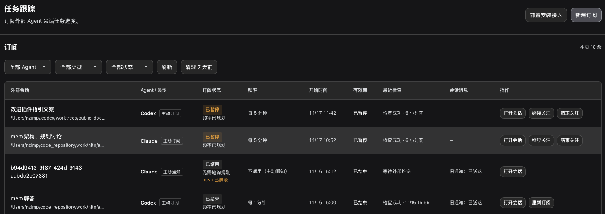
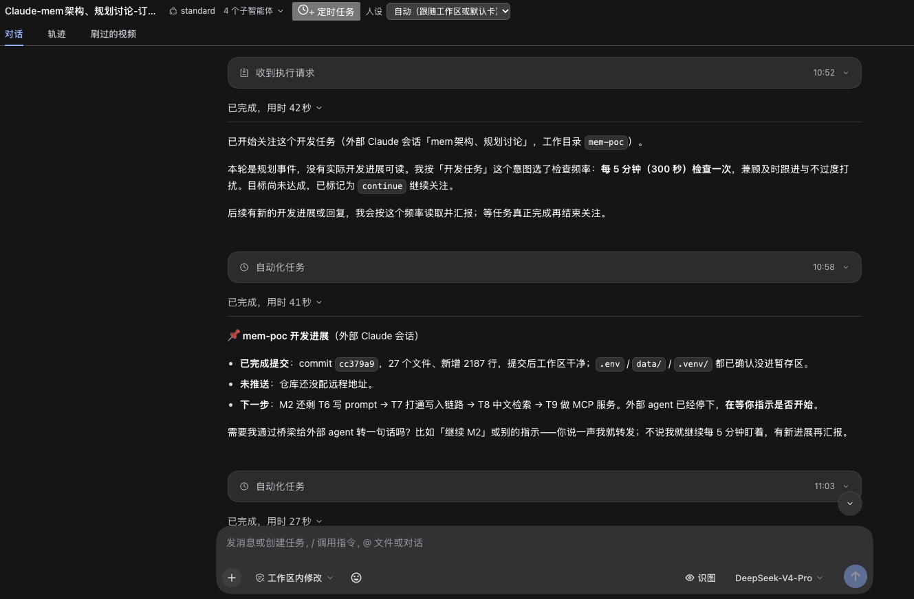
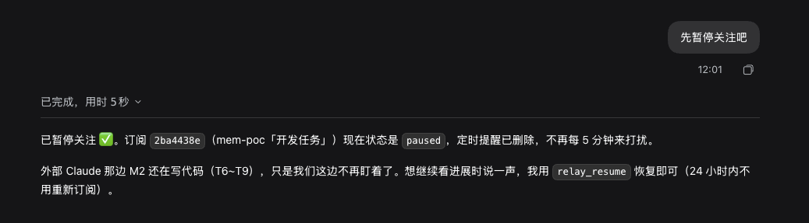
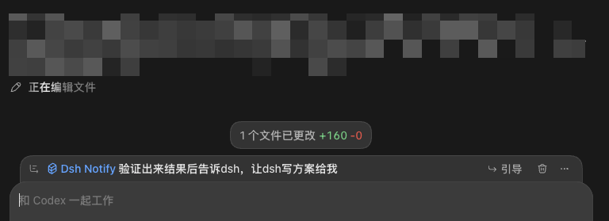
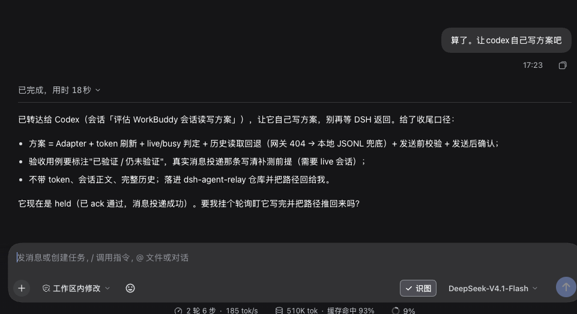
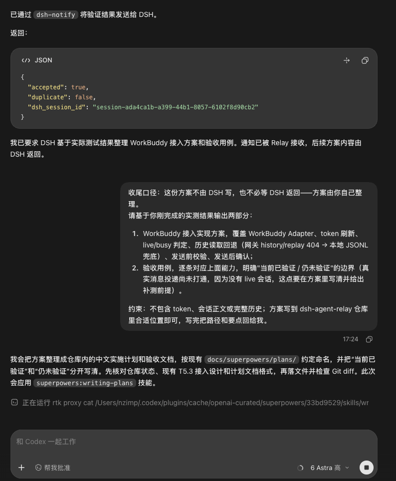
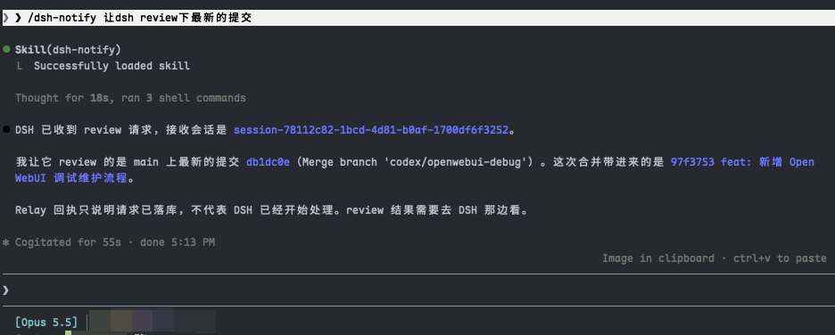

# DSH Agent Relay

[简体中文](README.md) | English

Connect Claude and Codex to your DSH conversations. Let your agents keep working while you check progress and receive results from other DSH clients.

1. **Follow external sessions:** Tell DSH which session to follow, what progress matters, and how often to check. Receive updates when relevant changes occur.
2. **Send messages to external sessions:** Add instructions in a DSH conversation and forward them to a specific Claude or Codex session.
3. **Receive proactive notifications:** External agents use the `dsh-notify` skill to send progress or results to DSH without waiting for the next scheduled check.

## When to use it

- **Follow tasks after leaving work:** Keep an agent fixing issues or running tests on your work computer, and check progress from another DSH client.
- **Reduce interruptions during meetings:** Follow only failures, blockers, and decisions that need your input, then review updates from the DSH client at hand.
- **Get notified when results are ready:** Ask an agent to notify DSH when tests finish or a blocker appears, then check the results from another client without repeatedly asking for status.
- **Add instructions during long tasks:** Send new requirements from DSH to the original session while a code review or refactor is in progress.

Other clients must connect to the same DSH service and have access to the relevant conversation. The machine running DSH and the external agents must remain powered on and awake, with the required services running.

## Showcase

Use the Task Tracking panel (任务跟踪) to view external sessions, subscription status, check intervals, and recent check results. Open sessions, resume monitoring, or stop following them from the same panel.

The screenshots below show the Chinese interface.

### Subscribe to progress and pause monitoring in DSH

Subscribe to an external session using natural language. DSH checks at the planned interval and reports relevant progress.

Pause monitoring when you no longer need updates for a while. This screenshot shows a pause: monitoring can resume within the original validity window. Use Stop Following (结束关注) to end it permanently.

### Proactive Codex notifications and messages back from DSH

Use `dsh-notify` in Codex to request a notification to DSH once verification finishes.

After receiving a notification, send follow-up instructions from DSH to the original Codex session.

Codex displays the notification receipt and continues handling instructions sent back from DSH. The receipt confirms that Relay accepted the notification, not that DSH has finished processing it.

WorkBuddy is the topic of the conversation shown in these screenshots; it does not indicate that the plugin currently supports WorkBuddy integration.

### Proactive notifications from Claude CLI

Call `/dsh-notify` in Claude CLI to send requests, such as a code review, to DSH and view the notification receipt.

## Getting started

### 1. Install and connect

Requires Node.js 24 or later. DSH and Claude/Codex must run on the same machine under the same user account. The declared DSH compatibility range is `>=0.2.0 <0.3.0`, and the current dependency version is `0.2.1-rc.2`. Full acceptance testing in a real DSH host is not yet complete; other versions require separate verification.

Install and enable the `.tgz` package through DSH's plugin manager. After restarting, open Task Tracking → Prerequisite Setup (任务跟踪 → 前置安装接入) and follow the instructions to install the notification skill for each agent you need. Forwarding messages to Claude terminal sessions also requires enabling the channel and reopening the session. Sending messages to Codex requires an available local daemon.

Install the bundled `dsh-agent-relay` skill in the project used by DSH so it handles subscriptions and messages according to the session bridge rules. See the [installation, skill configuration, and upgrade guide](docs/operations/T0-T1-T3-T7-plugin-release.md) (in Chinese) for details.

### 2. Ask directly in a DSH conversation

**Subscribe before leaving work:**

> I'm leaving work. Follow the Codex session that's fixing the login issue. Check every 5 minutes and tell me about test results and anything that needs my attention.

**Follow only important progress during a meeting:**

> I'm heading into a meeting. Subscribe to the Claude session doing the code review, and report only blockers and anything that needs my confirmation.

DSH finds candidate sessions and asks you to verify the target. If several sessions share a title, further confirmation is needed. You can specify a check interval or let DSH choose and tell you. Once subscribed, view the topic, actual interval, and deadline in Task Tracking. The panel also supports New Subscription (新建订阅).

**Add instructions:**

> Send a message to the Codex session we're following: add regression tests for login failures first, and don't commit the code yet.

**Stop following:**

> Stop following this session.

### 3. Ask external agents to notify you proactively

In a Claude or Codex session with the notification skill installed, say:

> I'm stepping away from my computer. When these tests finish or you hit a blocker that needs my input, use dsh-notify to notify DSH. Include a summary of the results and anything I need to confirm.

Then open the corresponding conversation from another DSH client to view progress and notifications. Notifications are routed from the external session to its associated DSH conversation. If DSH is busy, notifications are queued until it is available. Proactive notifications can still arrive after a subscription ends; block them separately if you want to stop receiving them.

## Usage notes

- Each monitoring window lasts at most 24 hours. Pausing or restarting does not extend it. DSH stays silent when there are no relevant changes, and a completed turn does not necessarily mean the monitoring goal has been reached.
- “Sent” does not mean the task is complete. If the delivery outcome is unknown, check the original session before retrying to avoid duplicate messages. Being able to read Codex history does not necessarily mean messages can be sent to that session.
- The plugin is designed for a single local user. Credentials stay in a private local directory and must not be committed to the repository. Uninstalling preserves data; follow the [upgrade guide](docs/operations/T0-T1-T3-T7-plugin-release.md) (in Chinese) to back it up before upgrading.
